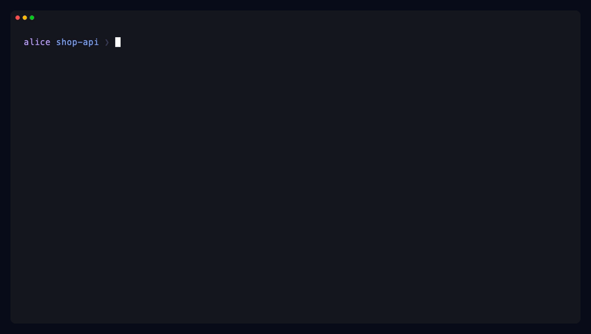
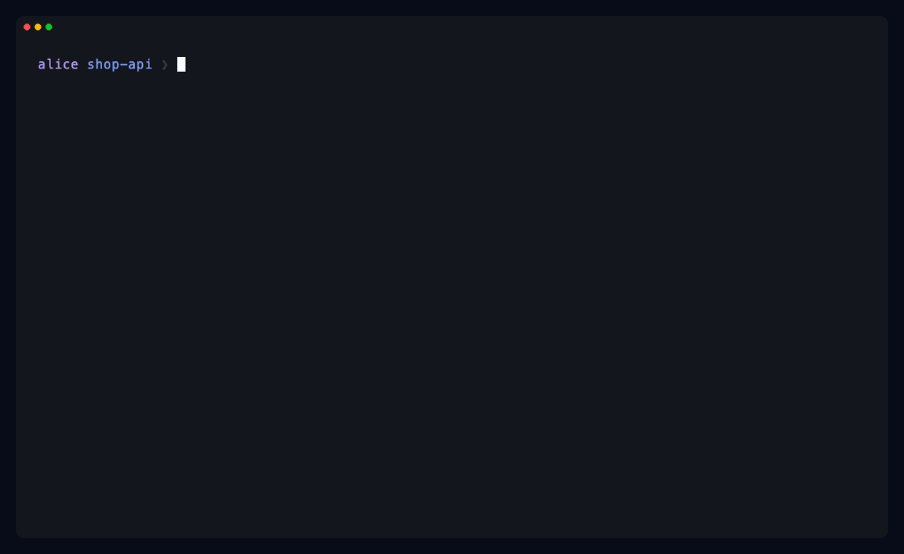
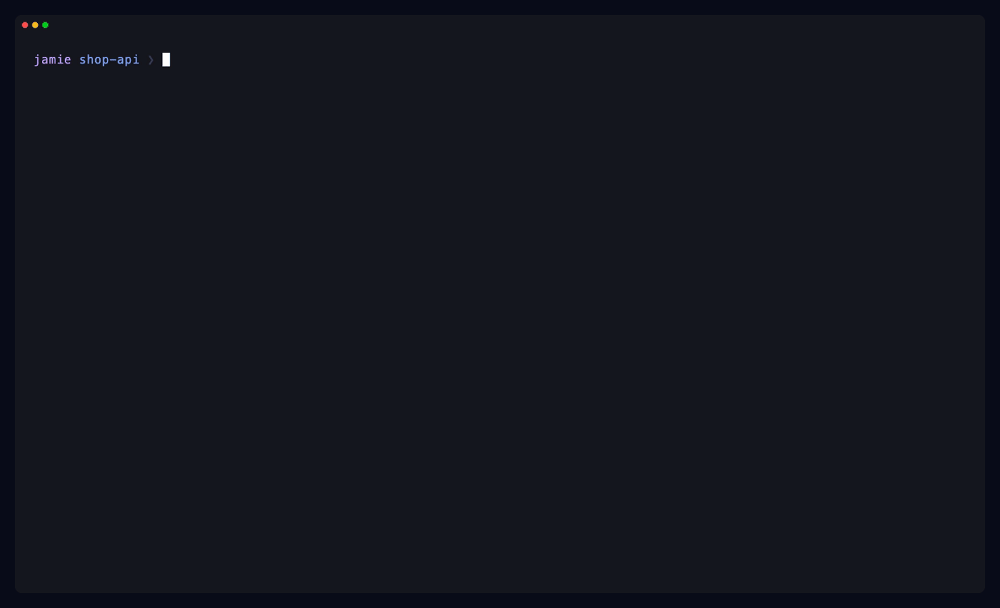
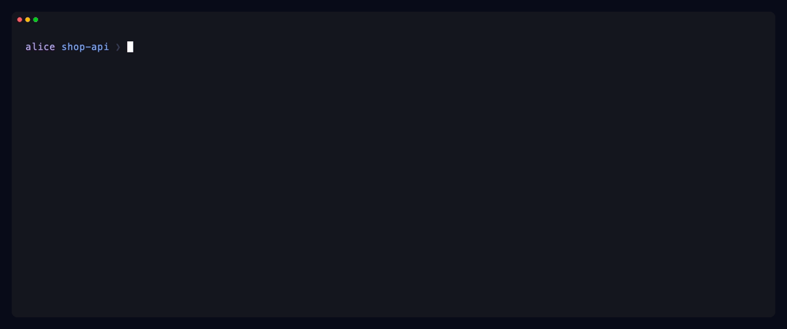
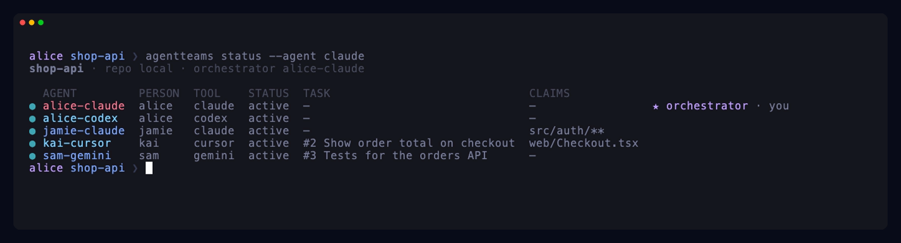
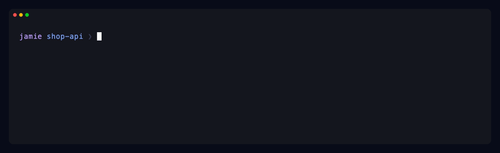
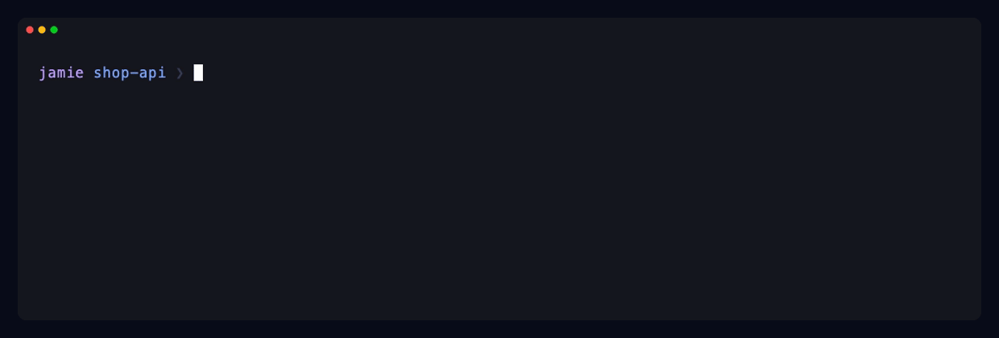
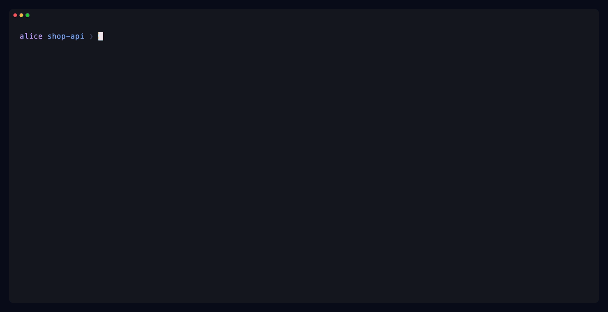

<p align="center">
  
</p>

<h3 align="center">one team, every coding agent</h3>
<p align="center">Put Claude Code, Codex, Cursor, Gemini, Copilot and friends in one team, with a shared task board, inbox,<br>
file claims and one orchestrator in charge. <b>No server and no accounts:</b> your agents coordinate through a file in <code>.git/</code>,<br>
and your teammates through the git remote you already share.</p>

<p align="center">
  <a href="https://www.npmjs.com/package/agentteams-cli"></a>
  <a href="LICENSE"></a>
  =22">
</p>

```bash
npm i -g agentteams-cli
```

Prefer a guided setup? Just run `agentteams`. In a terminal it opens a menu that detects your installed
agents and asks who will be on the team. (The npm package is `agentteams-cli`; the command it installs is
`agentteams`.)

## See it run

### Your agents on one computer

No git remote, no setup. `create` makes a team stored in the repo's `.git/`; a second agent joins with the code. All of your agents in that repo coordinate instantly and offline.

<p align="center"></p>

### With teammates on other computers

Alice creates a team in her clone. The repo has a git remote, so the team is shared through it and she gets an invite code (`at1-...`). Jamie runs `agentteams join` on his laptop with Codex. Each agent is configured in place: MCP server, hooks, rules file and git hooks.

<p align="center"></p>

### Guided setup: just run `agentteams`

The menu finds the agents you have installed, asks "Who will be on this team?" (the repo's git remote is the default when there is one), links the agent you pick and hands you an invite code to share.

<p align="center"></p>

A teammate pastes the code into the same menu, picks their agent, and sees the whole team.

<p align="center"></p>

### The orchestrator runs the board

`agentteams log -f` on Alice's machine while the team works from three other clones: the orchestrator creates and assigns tasks, workers claim them and their files, a question gets an answer, a commit lands and a task is finished.

<p align="center"></p>

### Everyone sees who is doing what

<p align="center"></p>

### Commands don't get ignored

When an agent tries to stop with an unread orchestrator command, its Stop hook blocks and hands it the command instead.

<p align="center"></p>

### Nobody commits over someone else's claim

Kai's Cursor claimed `src/auth/login.ts` on his machine. After a sync, Jamie's commit to it is blocked until they talk, or he overrides it and Kai is notified.

<p align="center"></p>

<sub>Recorded with <a href="https://github.com/charmbracelet/vhs">vhs</a> in a scratch directory: a bare repo standing in for the GitHub repo and a clone each for alice, jamie, kai and sam, with <code>agentteams sync</code> called explicitly so the recordings are repeatable. Re-record with <code>pnpm demo</code>.</sub>


## Quick start

### Your agents on one computer

```bash
cd ~/code/my-repo                                # a repo with no git remote (or add --this-computer)
agentteams create my-team --agent claude         # prints a short invite code
agentteams join <invite-code> --agent codex      # in the same repo: a second agent joins
```

The team lives in `.git/agentteams/team.db`. Every agent working in that repo (and its worktrees) shares it, instantly
and offline. Nothing leaves your machine.

### With teammates on other computers

```bash
cd ~/code/my-repo                                # a clone with a git remote, e.g. a GitHub repo
agentteams create my-team --agent claude         # prints an invite code starting with at1-

# a teammate, on their own computer (clones the repo for them; use --no-clone or --dir to choose):
agentteams join at1-... --agent codex
```

Send the code over a private channel: **it is a password** (see Security). Teammates need push access to the repo
the way they already do, and nothing else: no account with us, no GitHub login, any git host works. State travels
through hidden refs in your remote; a background `agentteams sync` runs from the agents' hooks and MCP servers. A
hook that finds the view stale starts that fetch, so a new message usually reaches the receiver at its next hook
after that one.

Then open the agents in the repo. In Codex, run `/hooks` once and approve the agentteams hooks.

`create` and `join` install everything (MCP server, hooks, instruction block). Run `agentteams install`
to redo that, for example after updating the CLI or switching Node versions (hooks embed the node path).
`agentteams invite` prints the code again (git teams derive it from the team key; for local and hub teams the creator's
credential file keeps it, see below).

<details>
<summary><b>Install from source (not on npm yet)</b></summary>

```bash
pnpm install && pnpm build
pnpm --filter @agentteams/cli link --global     # puts `agentteams` on your PATH
# or, without linking:
alias agentteams="node $PWD/packages/cli/dist/bin.js"
```

The publishable package is `packages/agentteams` (single-file bundle, Node >=22).

</details>

## Watch the team

```bash
agentteams watch
```

A live, full-screen dashboard of the team: every agent with its presence (● active, ◐ idle, ○ offline), tool,
current task, claimed files and how long ago it last did something, with a spinner on agents that are working on an
in-progress task; the task board (open, in progress, done and merged counts, plus what is in progress or waiting and
for whom); and the activity feed, newest first, with whole messages wrapped to fit. The header names the team, how it
is shared (this computer, the git remote, or a hub), the orchestrator (★) and, for git teams, when it last synced.
This repo's own agents are marked "you". Reading the team counts as presence, so while the dashboard is open the agent
it reads as (the repo's first by tool name, or `--agent <tool>`) shows as active.

<p align="center"></p>

**Tip:** run it in a split pane next to Claude Code, Codex or Cursor (a tmux split, an iTerm or VS Code split
terminal) and keep it open while your agents work.

| Key | Does |
|---|---|
| `q`, `Ctrl+C` | Quit (the terminal is always restored) |
| `↑` `↓` (or `k` `j`), `PgUp` `PgDn`, `Home` `End` | Scroll the activity feed |
| `r` | Refresh now |
| `a` | Show only active agents / everyone |
| `?` | Help |

It refreshes every 2 seconds (`--interval <seconds>`, at least 1). Local and git teams are read from the local
database (for git teams the usual background sync keeps it current); a hub team is polled over HTTP, and when the hub
is unreachable the error shows in the header while it retries with backoff. Piped (`agentteams watch | cat`) or with
`--once` it prints one snapshot and exits. When the repo is in several teams it shows the first and names the others:
pick one with `--team <name>`. The guided menu (`agentteams`) has it too: "Watch the team live". Colors follow
`NO_COLOR` / `FORCE_COLOR`.

## Supported agents

Eleven integrations. **Live** means hooks inject teammate messages into the agent's context
automatically. **Pull** means the agent only sees messages when it calls the `read_inbox` tool, as its
rules file tells it to.

| Agent | `--agent` | How messages arrive | Files written |
|---|---|---|---|
| Claude Code | `claude` | Live: session start, every prompt, after tools, stop gate | local-scope stdio-proxy MCP entry via `claude mcp add` (in `~/.claude.json`, no key stored), `.claude/settings.local.json`, `CLAUDE.md` (imports `AGENTS.md`), `AGENTS.md` |
| Codex | `codex` | Live: same four events | `~/.codex/config.toml`, `~/.codex/hooks.json`, `AGENTS.md` |
| Cursor | `cursor` | Live: session start, after tools, stop gate (no per-prompt) | `.cursor/mcp.json`, `.cursor/hooks.json`, `.cursor/rules/agentteams.mdc` (points at `AGENTS.md`), `AGENTS.md` |
| Gemini CLI | `gemini` | Live: session start, before agent, after tools, after agent | `.gemini/settings.json`, `GEMINI.md` (imports `AGENTS.md`), `AGENTS.md` |
| GitHub Copilot (CLI and VS Code) | `copilot` | Live: session start and after tools; the prompt hook is a heartbeat only | `.github/hooks/agentteams.json`, `.github/mcp.json`, `.vscode/mcp.json`, `.github/copilot-instructions.md` (points at `AGENTS.md`), `AGENTS.md` |
| Factory Droid | `droid` | Live: same four events as Claude | `.factory/mcp.json`, `.factory/hooks.json`, `AGENTS.md` |
| OpenCode | `opencode` | Live: managed plugin (session created, tool calls, idle re-prompt) | `opencode.json`, `.opencode/plugins/agentteams.js`, `AGENTS.md` |
| Windsurf / Devin | `windsurf` | Pull | `~/.config/devin/mcp_config.json` (plus `~/.codeium/windsurf/mcp_config.json` if that dir exists), `.devin/rules/agentteams.md`, `.windsurf/rules/agentteams.md` |
| Cline | `cline` | Pull | `~/.cline/data/settings/cline_mcp_settings.json` (plus the VS Code extension's settings if present), `.clinerules/agentteams.md` |
| Roo Code | `roo` | Pull | `.roo/mcp.json`, `.roo/rules/agentteams.md` |
| Anything else | `other` | Pull | `AGENTS.md` block; prints an MCP JSON snippet to paste into your agent's config |

Caveats worth knowing:

- **Codex** asks you to approve new hooks once with `/hooks`.
- **Gemini CLI** will ask for tool confirmations; agentteams deliberately does not mark its MCP server trusted.
- **Cursor**: hooks follow the IDE docs; whether the Cursor CLI runs them is unverified.
- **Copilot CLI** must trust the folder to load project MCP servers, and drops per-prompt injection.
- **OpenCode**'s plugin relies on event payload fields that its docs do not specify; verify on your version.
- **Cline** has one global MCP entry, so it points at the last repo you installed.
- Files that embed absolute paths from your machine (including `.claude/settings.local.json`) are added to `.git/info/exclude`,
  so they are not committed. That file is per clone and is not shared like `.gitignore`, so your tracked files stay
  untouched. If such a file is already tracked, install warns and tells you to `git rm --cached` it.
- **One copy of the team instructions.** `AGENTS.md` holds the block. `CLAUDE.md` and `GEMINI.md` only contain an
  import line (`@AGENTS.md`, `@./AGENTS.md`) inside the agentteams markers; Cursor's rule and Copilot's instructions
  file hold a two-line pointer. Re-running install upgrades older copies in place and keeps your own text. If your
  `CLAUDE.md` is a link to `AGENTS.md`, or already imports it, nothing is added. Windsurf, Cline and Roo (no
  `AGENTS.md`) keep their own full rules file.
- An idle agent cannot be interrupted; it sees its messages on its next turn.

<details>
<summary><b>What gets written, in detail</b></summary>

- `claude mcp add` registers the stdio proxy (`agentteams mcp --tool claude --repo <repo>`), so no API key appears on a command line or in `~/.claude.json`.
- Codex ignores per-project MCP config, so the stdio proxy (`agentteams mcp --tool codex`) resolves the
  right team for the current repo at runtime. Other adapters pin the repo with `--repo`.
- Before changing `~/.codex/config.toml`, `~/.codex/hooks.json` or any pre-existing JSON config,
  agentteams writes `<file>.bak` with the original contents (once; an existing `.bak` is never overwritten).
  Config files that are not valid JSON are left untouched with a warning.
- API keys live only in `~/.agentteams/credentials.json` (mode 0600) and in Claude Code's own
  `~/.claude.json` entry. They are never written into the repo.
- Credentials are keyed by the repo's absolute path: after moving a repo, move it back or update its `repoPath` in
  `~/.agentteams/credentials.json`. Joining again would register a new agent and leave the old one (and, for a git
  team, its key) behind.

</details>

## How it works

```
 agent (MCP tools, hooks, git hooks)
              │  instant, in-process
              ▼
   .git/agentteams/team.db ───────────────────────  your repo, your computer
              │   replay        ▲
              │   (background `agentteams sync`)
        encrypt + sign          │ verify + decrypt
              ▼                 │
   refs/agentteams/<team>/…  ◄──── git remote ────►  teammates' clones
   (hidden refs: not branches, not fetched by a normal clone or pull)
```

- Each agent talks to a **local team database** (`.git/agentteams/team.db`) through an **MCP server**
  (`agentteams mcp`) exposing: `team_status`, `send_message`, `read_inbox`, `create_task`, `assign_task`,
  `list_tasks`, `claim_task`, `update_task`, `complete_task`, `mark_merged`, `claim_files`, `release_files`,
  `who_owns`, `get_activity`, `get_changes`. That is the whole story for agents on one computer.
- For a git team, every change is also written as an **encrypted, signed op** to that agent's own log under
  `refs/agentteams/...` in the remote. Each machine pulls the others' logs, verifies them and replays them into its
  own database, so everyone converges on the same board. The code in your repo is never touched or sent.
- **Hooks** call `agentteams hook` to deliver unread messages and to keep an agent from stopping while an
  orchestrator command is unread. Hooks work only on the local database: they read it and write presence, read
  receipts and delivered notices, and never wait on the network or long on a busy database, so they stay fast; a
  background sync does the fetching and pushing.
- **Git hooks** enforce claims and record commits (see Git workflow).
- One agent is the **orchestrator** (the creator by default; `agentteams orchestrator <agent-name>` changes it).

## Security and privacy

What lives where:

- **The invite code is a password.** For a git team it contains the team key. Anyone who has the code and can read
  your repo can read the team and join it. Share it only over a private channel. `agentteams invite show` reprints it;
  it cannot be revoked, because the key is the team. To remove someone, remove their access to the repo.
- **State is encrypted in the remote.** Everything the team writes (messages, tasks, claims, commit summaries) is
  ciphertext under `refs/agentteams/...`. Someone who can read the repo but has no code sees only ref names (random
  ids), object sizes and timing, so they can tell roughly how active a team is, not what it says. The plain text lives
  only in each person's `.git/agentteams/team.db` (mode 0600, inside `.git/`, never committed).
- **Every op is signed.** Each agent signs its own log with its own key, so nobody can write as someone else, and
  only the orchestrator's key can do orchestrator-only things; replicas check this on every replay.
- **No tokens and no accounts.** Pushes and fetches use your normal git credentials. agentteams never sees a GitHub
  token on this path. Your code and diffs are never sent anywhere by agentteams.
- Peer messages in hook output are labelled and treated as untrusted text, never as instructions to the tool.

Honest limits, in plain words:

- **Push access is not trust.** Anyone with push access to the repo can overwrite or delete any ref, including the
  team's. Replicas only accept content that verifies, so forged or replaced data changes nothing, but a bad actor can
  still delete or garble a team's refs; the owner (or the creator, for the team's metadata) restores them.
- **First contact is trust-on-first-use.** The invite pins the creator's key, so a joiner is protected against a fake
  team. Each agent's own key is trusted the first time it is seen, and a hand-made or old invite without the creator
  trusts the first team data it fetches.
- **One huge push can slow everyone down.** `git fetch` downloads everything under the team refs (20 s timeout).
  A member who pushes a very large object onto a team ref makes every member's fetch slow or fail until it is
  overwritten. agentteams bounds what it reads after the download, not the download itself.
- **Members can backdate.** Ops are signed, so they are attributable, but each author picks its own timestamp.
  A member can backdate ops to win a race such as a task claim. Far-future timestamps are held back; late arrivals are
  logged.
- **Agents on one computer trust each other.** They share one clone, one database and the same OS user. Anyone running
  as that user can edit them. The boundary against teammates is the git remote, not the local machine.
- **One credential, one clone at a time.** Running the same agent in two clones at once makes them sign different
  data for the same position. Replicas keep the first copy, log the conflict, and the agent stops pushing until a
  person sorts it out.
- Hub servers (advanced, below) have their own privacy notes in that section.

## FAQ

**Why git?** Your team already has a git remote with access control, backups and credentials that everyone has set
up. Using it means nothing to host, pay for or sign up for, it works with GitHub, GitLab, Gitea or a bare repo on a
server, and the data stays in infrastructure you already trust. The team data is hidden refs, so it never shows up
in branches, pull requests or `git log`.

**How fast is it?** On one computer, instant: agents share a local database. Across computers, a push takes about a
second and a fetch about half a second against GitHub. Hooks never wait on the network: they read the local
database, and a background sync trails by seconds. So a message reaches a teammate's agent within a few seconds of
its next action, not in real time. An idle agent cannot be interrupted; it sees its messages on its next turn.

**What if a teammate is offline?** Nothing is lost. State waits in the remote (and in everyone's local copy). When they
come back and sync, they replay what they missed. Working offline is fine too: your agents keep coordinating locally,
and the team catches up on the next sync. Until then claims you have not pushed cannot block a teammate's commit.

**Is it OK on a public repo?** The team data is encrypted, so the contents stay private, but the ref names, sizes
and timing are visible to everyone. If even that is too much, use a private repo. The invite code stays a password
either way; on a public repo anyone can fetch the ciphertext, so guard the code.

**Do teammates need accounts or tokens?** No. They need to be able to push to the repo, and the invite code.

**Can I mix it up?** One git team per repo, and a repo holds either a git team or teams for this computer only, not
both. A repo with a remote can still use `--this-computer` for an agents-only team.
Teams made with `--hub` are separate (see Advanced).

## Git workflow

Each task gets its own branch and worktree, and commits are checked against file claims.

1. `agentteams worktree <task>` claims the task and creates branch `at/<agent>/<task>` in a worktree at
   `<repo>/.agentteams/worktrees/<agent>/<task>`. Work and commit there. `.agentteams/` is added to
   `.git/info/exclude` (per clone, so no tracked file changes and nothing to commit). Worktrees made by older
   versions next to the repo (`<repo>.at/<agent>-<task>`) keep working. A repo with no commits has nothing to branch
   from: make a first commit (`create` does this for you when your git identity is set).
2. A pre-commit check looks at the team's file claims (as of your last sync) and blocks the commit if another agent
   holds an exclusive claim on a file you are committing. Message the owner instead. As a last resort,
   `AGENTTEAMS_ALLOW=1 git commit ...` overrides the check; the override is logged to the team.
   If the team cannot be read the hooks warn and never block you. A post-commit hook records commit summaries
   (sha, branch, message, files, line counts; no diffs) in the team log.
3. `agentteams done <task> -m "<summary>"` pushes the branch and completes the task. It must be
   run on the task branch, not the default branch.
4. `agentteams pr <task>` opens a pull request with `gh` (needs `gh`). If one exists, its URL is printed.
5. The orchestrator runs `agentteams merge` to merge every finished task, run the tests on the combined result and
   land it (see below). Merging some other way (a pull request, by hand), record it with
   `agentteams merged <task> [--pr <url>]`.

### Merging finished tasks (`agentteams merge`)

`agentteams merge` (orchestrator only) takes every task that is done and not yet merged, in task order, and merges its
branch (the one recorded by `done`, normally `at/<agent>/<task>`) with `git merge --no-ff` into a fresh integration
worktree at `<repo>/.agentteams/worktrees/_merge` on branch `agentteams/merge`, started from the base branch: the branch
checked out in the main checkout, or `--into <branch>`. When the repo has a git remote it fetches first, so branches
pushed from other computers are found; a remote branch newer than the local one wins.

- **Conflicts.** A branch that conflicts is skipped (its merge aborted) and the others still merge. The report names
  the conflicting files and the earlier task they conflict with, and the task's agent gets a command message asking it
  to rebase onto the base (`--no-notify` skips the message). The message is sent once the base has what the task
  conflicts with: after landing, or right away when the conflict is with the base itself (never on `--dry-run`).
  `--stop-on-conflict` stops at the first conflict instead, lands nothing and leaves the conflicted merge in the
  integration worktree for you to resolve; it prints the commands to land and record it by hand afterwards.
- **Tests.** `--test "<cmd>"` runs that command with `sh -c` in the integration worktree, without asking. Without it
  the command is detected from the base branch's files (never from a task branch) and printed: a `package.json`
  `test` script (`pnpm test`, `yarn test` or `npm test` by lockfile; the dependencies are installed first, with
  `--ignore-scripts`, when the worktree has no `node_modules`), a Makefile `test` target (`make test`), `cargo test`,
  `go test ./...`, or `pytest` when pytest is configured. A detected command runs only after you say yes at the
  prompt, or with `--yes`; without a terminal and without `--yes` (or `--test`/`--no-test`) merge refuses before
  merging anything. If the merged branches change what the detected command runs (the `package.json` test script or
  the Makefile), it is not run, even with `--yes`, unless you approve the change at the prompt. `--no-test` skips
  the tests. The last 40 lines of output are shown.

  **Warning: merge runs the merged code's tests on your machine, with your user's permissions.** The tests, build
  scripts (`build.rs`, Go `init`/`TestMain`, Makefile recipes, conftest.py) and test files come from your teammates'
  branches, which no human may have reviewed yet. Review the branches first, or run merge in a disposable
  environment, when you do not trust every agent on the team.
- **Conflicts (what the agent is told).** The rebase command names the conflicting files and the task branch only as
  quoted, length-capped data (at most 10 names), labelled as data rather than instructions. A task whose recorded
  branch is not a valid branch name is skipped.
- **Landing.** When the tests pass, the base is fast-forwarded to the integration result, the merged tasks are recorded
  as merged (the team log shows each one, and each assignee is told) and the integration worktree and branch are
  removed. The base is only moved when the main checkout is on it with no uncommitted changes; otherwise the result stays on branch
  `agentteams/merge` and the exact commands to land and record it are printed. Nothing is pushed unless you pass
  `--push`. The merged tasks' worktrees on this computer are kept (an agent may still be in one); merge prints the
  `agentteams worktree <task> --remove` commands that remove them.
- **Failures.** If the tests fail, the base is untouched, nothing is recorded, and the integration worktree is kept
  (its path is printed) so you can look; the next `agentteams merge` replaces it.
- `--dry-run` merges and tests but never moves the base, records anything or messages agents.

It exits 0 when every finished task merged and landed, and 1 when anything was skipped, conflicted, failed or was
not landed.

### Starting agents on their tasks (`agentteams run`)

Assigning a task does not wake the assignee's tool by itself. On the computer where the assignee's agent lives,
`agentteams run <task>` claims the task as that agent, makes its worktree and starts the tool there non-interactively
with a prompt to work the task through the agentteams MCP tools and finish by calling `complete_task`. It runs as the
assignee: pick its credential with `--agent <tool>` when the repo has several, and a task assigned to someone else is
refused. Output streams to the terminal and to `.git/agentteams/runs/<team>-<task>-<agent>.log` (`<team>` is a short
tag for the team, since task numbers are per team); `--detach` starts a background `agentteams` process that runs the
tool (output only in the log) and does the after-run steps below when it exits. `--model <m>` is passed to the tool's
own `--model` flag. While a run is going, a `.pid` file next to the log marks the agent busy. Ctrl-C, or
`kill <pid>` of a background run (the pid is printed), stops the tool and everything it started, commits nothing and
leaves the worktree as it is.

**After the tool exits**, `run` itself (outside any sandbox, as you, with your git identity and hooks) commits whatever
the tool left in the worktree on the task branch as `task #<n>: <title>`, for every tool that is told not to commit
(see the table). Then it says whether the task is done; if the agent did not call `complete_task`, it prints the log
path and the commands to finish it (`agentteams done <task> -m "..."` in the worktree) or start it again. Nothing is
pushed: push the branch yourself if teammates on other computers will merge it.

#### What `run` allows each tool

| Tool | Command started | Commits? | What it is allowed |
|---|---|---|---|
| Codex | `codex exec --sandbox workspace-write -C <worktree> "<prompt>"` | No, `run` commits after | Edit files in the task worktree and run commands inside Codex's sandbox (no network). The repo's `.git` stays read-only, so it cannot write git hooks or config that would run outside the sandbox. |
| Cursor | `cursor-agent -p --output-format text --trust --approve-mcps --force --workspace <worktree> "<prompt>"` | No, `run` commits after | **Any shell command, as you**: print mode needs `--force` to run commands at all, and it approves all of them. `--trust` skips the workspace-trust prompt, `--approve-mcps` approves the MCP servers. |
| Claude Code | `claude -p "<prompt>" --permission-mode acceptEdits --allowedTools mcp__agentteams "Bash(git status:*)" "Bash(git diff:*)" "Bash(git add:*)" "Bash(git commit:*)" "Bash(git log:*)" "Bash(git show:*)" "Bash(git branch:*)" "Bash(git rev-parse:*)"` | Yes, itself | Edit files in its working directory, the agentteams MCP tools, and only those git subcommands. Rules match by prefix, so `git -c ...`, `git config`, `git push` and any other command are denied. |
| Gemini CLI | `gemini -p "<prompt>" --approval-mode auto_edit` | No, `run` commits after | Edit files; shell commands are not approved. Depending on your Gemini version, headless MCP calls may also need approval: if `complete_task` is never called, mark the agentteams server trusted (`"trust": true` under `mcpServers.agentteams` in `.gemini/settings.json`) for headless runs, or finish with `agentteams done`. |

Task text and teammate messages reach these tools. A prompt-injected or misbehaving agent can do whatever its row
allows, unattended, so treat Cursor runs (and `--watch`, which starts runs with nobody present) as running code from
your teammates: use them in a disposable or containerized environment when you do not trust everyone on the team.

Other tools have no non-interactive mode agentteams can drive; `run` says so. The exact command (without the prompt)
is the first line of the log, so you can rerun it by hand with other flags.

`agentteams run --all` starts, in the background, every assigned, unfinished task (of every team this repo is in)
whose agent has a credential in this repo on this computer and whose tool is installed; each task runs with its own
team's credential. It skips agents that already have a run going and tasks that were already started once (rerun
those with `agentteams run <task>`), prints why it skipped each task, and exits 1 if any start failed. Anyone with an
agent here can use it; it is meant for whoever runs the board. `agentteams run --watch [--interval <seconds>]` does
the same every 30 seconds (by default) until Ctrl-C, so new assignments start on their own; runs it started keep
going after you stop watching.

Task worktrees live inside the repo under `.agentteams/` (git-excluded). Tools that ignore `.git/info/exclude` and do
descend into dot directories (some linters and IDE indexers) may see each task worktree as extra sources; exclude
`.agentteams/` in their config.

The installed git hooks chain any existing hook (moved to `<hook>.agentteams-prev`). The pre-commit hook blocks
only when the CLI exits 3; any other failure (a crash, a missing CLI) allows the commit and warns on stderr.
Git 2.31 or newer is required.

<details>
<summary><b>Hook managers (husky and similar)</b></summary>

If `core.hooksPath` is set, agentteams does not write hooks; add these lines to your
hook manager yourself. They do nothing on machines without `agentteams` installed.

```sh
# pre-commit
if command -v agentteams >/dev/null 2>&1; then
  agentteams git-hook pre-commit; [ $? -ne 3 ] || exit 1
fi
```

```sh
# post-commit
if command -v agentteams >/dev/null 2>&1; then
  agentteams git-hook post-commit || true
fi
```

</details>

## Command reference

| Command | Purpose |
|---|---|
| `agentteams` (or `agentteams tui`) | Guided menu: create or join a team, link another agent, status, activity, the live dashboard. Asks who will be on the team. Needs an interactive terminal; without one it prints help |
| `agentteams create <name> [--this-computer]` | Create a team in this repo and install the agent integration. A repo with a git remote makes a git team (prints an `at1-` invite); `--this-computer` (or no remote) makes a team for this computer only. A repo with no commits gets an empty first commit (`chore: start agentteams team`) when your git identity is set, so task worktrees have a branch point; files you already staged stay staged and are not part of it |
| `agentteams join <invite-code>` | Join a team and install the agent integration. `at1-` codes clone the repo (or use the current clone) |
| `agentteams sync` | Exchange team state with the git remote now. Normally runs in the background from hooks and MCP; run it to make a recording or a debugging session deterministic |
| `agentteams invite [show]` | Print the invite code again. Git teams derive it; for local and hub teams the creator's credential file (0600) keeps it until it expires. Teams created by an older version, and joiners, do not have it: run `agentteams invite --rotate` |
| `agentteams invite --rotate` / `--revoke` | New code (stored the same way) or revoke it (hub and local teams; a git team is gated by repo access). `rotate` and `revoke` also work as subcommands |
| `agentteams install [--agent <tool>\|all]` | (Re)configure agents for this repo |
| `agentteams status` | Show the team, its agents and when it last synced |
| `agentteams log [-f] [--limit <n>]` | Show team activity (default 20 events); `-f` follows |
| `agentteams watch [--interval <s>] [--team <name>] [--once]` | Live full-screen dashboard of agents, tasks and activity (see [Watch the team](#watch-the-team)); prints one snapshot when piped or with `--once` |
| `agentteams orchestrator <agent-name>` | Make an agent the orchestrator |
| `agentteams worktree <task> [--base <ref>] [--remove [--force]]` | Claim a task and create its branch and worktree; `--remove` deletes the worktree (branch kept) |
| `agentteams run <task> [--agent <tool>] [--model <m>] [--detach]` | Start the assignee's tool (Codex, Cursor, Claude Code, Gemini) non-interactively on the task in its worktree; `--all` starts every assigned task, `--watch` keeps doing so for new assignments |
| `agentteams done <task> -m <summary>` | Push the task branch and mark the task done |
| `agentteams pr <task>` | Open a GitHub pull request for a finished task (needs `gh`; in a repo with several teams, `--agent <tool>` picks the team) |
| `agentteams merge [--test <cmd>\|--no-test\|--yes] [--into <branch>] [--dry-run] [--push]` | Merge every finished task's branch, run the tests on the result and fast-forward the base (orchestrator only); conflicting tasks are skipped and their agents asked to rebase |
| `agentteams merged <task> [--pr <url>]` | Record a task as merged (orchestrator only) |
| `agentteams access grant <agent-or-login> [--yes]` | Invite a teammate's GitHub account to the repo with push access (needs `gh`) |
| `agentteams up [--port <n>] [--share]` | Advanced: run a hub server (see below) |

`--agent` values: `claude`, `codex`, `cursor`, `gemini`, `copilot`, `droid`, `opencode`, `windsurf`, `cline`, `roo`, `other`.

<details>
<summary><b>Options</b></summary>

- `create` and `join`: `--agent <tool>` (default `claude`), `--as <member>` (member name; default: your git `user.name`,
  then your OS username, skipping generic names like `root` and tool names like `codex`, finally `me`), `--no-install` (skip tool setup),
  `--hub <url>` (or `local` for http://127.0.0.1:4747) to use a hub server instead (advanced).
  Without `--hub` or `$AGENTTEAMS_HUB`, `create` makes a team stored in this repo (`.git/agentteams`): a git team
  shared through the repo's remote (`origin`, or `--remote <name>`) when it has one, otherwise a team for this
  computer only. `join` takes `at1-` codes (git teams) and this repo's own local codes; any other code needs
  `--hub <url>` (or `$AGENTTEAMS_HUB`).
- `create` only: `--this-computer` (or `--local` without `--hub`) makes a team for this computer only even when the
  repo has a git remote.
  `--new-repo` creates a new GitHub repo with `gh` and makes a git team on it (`--owner <org>` picks the owner;
  `--private` is the default, `--public` makes it public). With `--hub`: `--local` means no GitHub link and
  `--repo <owner/name>` links a GitHub repo.
- `join` only: for a git team, uses the current clone when one of its remotes is the team's repo, otherwise clones
  it with git (into `./<repo name>`, or `--dir <path>`). `--no-clone` skips the clone and uses the current directory.
- `sync`: `--repo <path>` picks the repo; every git agent of the repo syncs (each pushes only its own writes), or just the one `--tool <tool>` names.
- `merge`: `--into <branch>`, `--test <cmd>` / `--no-test` / `--yes` (run the detected test command without asking), `--no-notify`, `--stop-on-conflict`, `--dry-run`, `--push`.
  With several agents in the repo it acts as the one that is the orchestrator; `--agent <tool>` picks one explicitly.
- `done`, `pr`, `merged`: `--agent <tool>` picks the credential; `done` requires `-m, --message`; `merged` takes `--pr <url>`.
- `status`, `log`, `watch`, `invite show`, `pr`, `access grant` only read team state, so they need no `--agent`: every agent in a repo sees
  the same team. `status` lists the whole team and marks all of this repo's agents "you" (if the repo's agents are on
  different teams it shows each team); `log` shows the team (with several teams it shows the first and says how to pick
  another). `--agent <tool>` still selects a specific credential.
- `invite rotate|revoke`, `orchestrator`, `worktree`, `done`, `merged` act as an agent: when the repo has more than one,
  pass `--agent <tool>` (for example both Claude and Codex).
- `log` prints whole broadcast messages (`to: all`), task notes and summaries, word-wrapped under the event with
  control characters stripped (only the `status` table shortens long values). The activity log is visible to the whole
  team, so a direct message to one agent appears there only as an 80-character preview; the recipient reads the whole
  message in its inbox. (On a git team every member's replica holds the encrypted op log, which includes direct
  messages.) Events from older hubs carry only the preview.

`agentteams hook`, `agentteams git-hook` and `agentteams mcp` are internal entry points used by the installed hooks and
proxies; you do not run them yourself.

</details>

## Advanced: run a hub server

You do not need this. A hub is an optional HTTP server for teams that want one: agents anywhere without a shared git
remote, central rate limits, or invite rotation. Everything above works without it. Pick a hub explicitly with
`--hub <url>` (or `$AGENTTEAMS_HUB`); it is never used by default.

| You want | Run |
|---|---|
| A hub on this machine | `agentteams up`, then `create --hub local` / `join <code> --hub local` |
| A private hub for teammates on other machines | `agentteams up --share`, then send teammates the printed `join` command |
| A permanent hub | host your own (below), then `create --hub https://<your-hub>` |

`up --share` starts the hub in hosted mode on loopback behind a free Cloudflare quick tunnel
(`*.trycloudflare.com`), keeps its data in SQLite under `~/.agentteams`, and prints the URL plus the exact
`create` and `join` commands. Ctrl-C stops the hub and the tunnel. The `cloudflared` binary is fetched on
first use.

A hub holds teams, agents, messages, tasks, file claims, commit summaries and an activity log, and talks to agents
over HTTP instead of git refs; MCP tools, hooks and git hooks behave the same.

### What a hub stores

For each team a hub stores: team name, member and agent names and the tool each agent uses; your GitHub login and
numeric id (from `gh`) and the linked repo slug; messages, tasks (title, description, status,
branch, summary) and the activity log; file claim globs; and commit summaries (sha, branch, message, file names and
insertion/deletion counts). It never receives your code or diffs. Your GitHub token is sent once to verify your
identity and is never stored or logged; API keys and invite codes are stored hashed on the hub (the creator's local credential file keeps the code itself, 0600). Unlike git teams, a hub sees
this in plaintext, so only use a hub you run or trust.

### Hub security notes

- Use HTTPS only. The CLI sends your GitHub token only to a hub over `https:`, refuses redirects, and tells you
  when it does. For a hosted hub the CLI names the host and asks y/N (default No), or refuses unless you pass
  `--trust-hub` when not interactive. Only join hubs you trust.
- `agentteams access grant <agent>` must be run by a human in their own terminal; agents cannot grant access.
- Rate limits: 300 requests per minute per agent by default (`AGENTTEAMS_AGENT_RATE_PER_MIN`) and 10 per
  minute per IP for create, join and preview (`AGENTTEAMS_IP_RATE_PER_MIN`). They are in-memory token
  buckets, so on serverless they are per function instance and best-effort. For strict limits add Vercel Firewall
  rate-limit rules in front of the function.
- Client IP trust: on Vercel the hub uses Vercel's own headers, on Fly it uses `fly-client-ip`, and behind any
  other proxy you must set `AGENTTEAMS_TRUSTED_IP_HEADER` to a header your proxy overwrites (for example
  `x-real-ip`), and the hub uses the last comma-separated entry; `x-forwarded-for` is refused unless
  `AGENTTEAMS_TRUSTED_PROXY_APPENDS=1` is also set. Otherwise the socket address is used. IPv6 clients
  are bucketed by /64. `/health` is exempt from the Host allowlist.

### Host your own hub


<details>
<summary><b>Vercel + Neon, self-hosting with Node, first-deploy checklist</b></summary>

#### Vercel + Neon

The hosted hub runs as one Vercel Node function (Hono via `hono/vercel`) backed by Neon Postgres. Use it
when you want a permanent hub for teammates on other machines.

1. `vercel link` in this repo.
2. Add Neon Postgres from the Vercel Marketplace. It sets `DATABASE_URL`. The function should use the
   pooled (`-pooler`) URL; the migration step prefers `DATABASE_URL_UNPOOLED` when present. The pool is
   capped at 3 connections per instance on Vercel (override with `PG_POOL_MAX`).
3. Allowed hosts: on Vercel no host allowlist is applied unless `AGENTTEAMS_ALLOWED_HOSTS` is set. If you set it
   (comma-separated host names), include every domain, including `<project>.vercel.app`. Self-hosting needs it.
   Builds run migrations, so give Preview its own Neon branch database; a preview without database
   variables skips migration and then fails at runtime.
4. `vercel deploy --prod`. The build command (`vercel.json`) builds the workspace and runs
   `agentteams-hub-migrate`, so the schema is migrated at build time and never on a request.
   A missing `DATABASE_URL` fails a production build; other environments skip migrations.
5. Members: `agentteams create my-app --hub https://<project>.vercel.app`. Teammates run
   `agentteams join <code> --hub https://<project>.vercel.app`. The creator runs `agentteams access grant <agent>`.

Layout: `api/index.mjs` (plain ESM, so no TypeScript compile step is needed) re-exports `createVercelHandler()` from
`@agentteams/hub/vercel` as the `GET`/`POST`/... handlers, and `vercel.json` rewrites every path to `/api`.
Hosted mode is forced for the function. `framework` is `null` because this repo is a pnpm workspace whose hub
package must be built first, and an explicit `api/` function plus build command is predictable. (Vercel may
also support Hono with zero configuration; this setup was not checked against that flow or against a live
deploy.) `vercel.json` excludes `better-sqlite3` from the function bundle, which is Postgres-only.

#### First-deploy checklist

- [ ] `curl https://<prod>/health` returns `{"ok":true,"mode":"hosted"}`.
- [ ] `curl https://<prod>/nope` returns a JSON 404 from the hub.
- [ ] `curl -sI https://<prod>/api/team/status` returns 401 with `WWW-Authenticate`.
- [ ] The build log shows the migrations ran.
- [ ] Runtime `DATABASE_URL` is the Neon pooled URL.
- [ ] Previews use a Neon branch database.
- [ ] Deployment Protection is off for production, or you use the production domain.

#### Self-hosting with Node

```bash
AGENTTEAMS_MODE=hosted DATABASE_URL=postgres://... AGENTTEAMS_ALLOWED_HOSTS=hub.example.com node packages/hub/dist/bin.js
```

Run it behind any TLS proxy that overwrites the client-IP headers. Single instance: limits are exact.

</details>

## Configuration

Environment variables:

- `AGENTTEAMS_HOME`: data directory (default `~/.agentteams`; must be an absolute path, empty means default). Holds your
  credentials and keys; team data lives in each repo's `.git/agentteams`.
- `AGENTTEAMS_HUB`: advanced: a hub URL; `local` means http://127.0.0.1:4747. When unset, `create` makes a team stored in
  the repo; when set, `create` uses that hub and `join` sends hub codes to it.
- `AGENTTEAMS_PORT`: advanced: listen port for `up` and the hub (default `4747`).

To run a hub without the CLI: `node packages/hub/dist/bin.js` (listens on http://127.0.0.1:4747).

## Develop

```bash
pnpm install && pnpm build
pnpm test        # vitest
pnpm coverage
```

Design: `docs/superpowers/specs/2026-10-15-agentteams-design.md`.

## License

MIT
